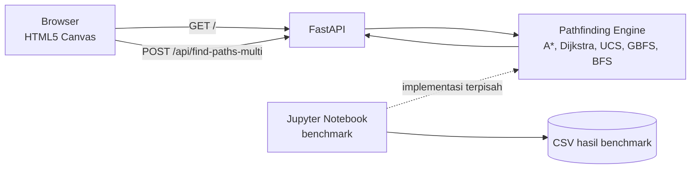
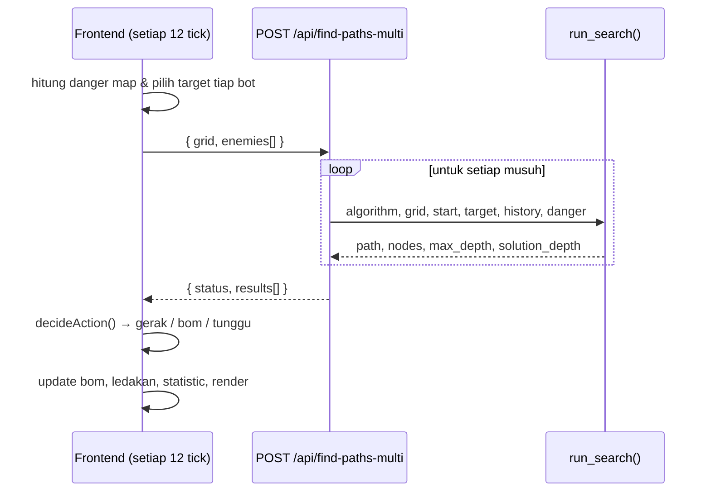

# Arsitektur

Dokumen ini menjelaskan bagaimana aplikasi Bomberman AI Pathfinding disusun: komponen, alur request, siklus permainan, pengambilan keputusan bot, dan aturan arena.

## 1. Gambaran sistem

Sistem terdiri dari tiga bagian:

1. **Backend FastAPI** (`main.py`) — memuat model Pydantic, engine pencarian path, dan endpoint REST.
2. **Frontend kanvas** — HTML/CSS/JavaScript yang dikirim langsung dari `GET /`; menjalankan simulasi, menggambar arena, dan memanggil API.
3. **Notebook benchmark** — implementasi algoritma yang berdiri sendiri untuk eksperimen batch dan ekspor CSV.



Aplikasi bersifat **stateless di sisi server**. Tidak ada sesi, database, atau penyimpanan skor. Seluruh state permainan (grid, posisi bot, bom, statistik) berada di browser. Server hanya menerima snapshot grid dan daftar musuh, lalu mengembalikan path beserta metrik.

## 2. Alur request



Properti penting:

- Satu request dapat memuat banyak musuh; server memprosesnya **berurutan** dalam satu loop.
- Tidak ada cache path; setiap panggilan menghitung ulang dari snapshot terbaru.
- Frontend memakai guard `isFetching` agar request baru tidak dibuat sebelum request sebelumnya selesai.
- Urutan hasil diproses di frontend secara acak 50:50 setiap tick untuk mengurangi bias giliran.

## 3. Model data

Didefinisikan dengan Pydantic v2 di `main.py`:

```python
class EnemyInfo(BaseModel):
    id: int
    pos: List[int]            # [baris, kolom]
    target: List[int]         # [baris, kolom]
    algorithm: str            # BFS | UCS | DIJKSTRA | GBFS | A_STAR | A*
    history: List[List[int]] = []
    danger: List[List[int]] = []

class MultiPathRequest(BaseModel):
    grid: List[List[int]]
    enemies: List[EnemyInfo]
```

Nilai grid:

| Nilai | Arti | Dapat dilalui pathfinding |
| --- | --- | --- |
| `0` | Lantai kosong | Ya, biaya `1.0` |
| `1` | Dinding permanen | Tidak |
| `2` | Dinding kayu | Ya, biaya `5.5` |
| `3` | Bom aktif | Tidak (ditangani escape planner frontend) |
| `4` | Ubin runtuh | Tidak |

Server hanya menerima `0` dan `2` sebagai ubin yang dapat dilalui. Bom dan ubin runtuh otomatis dianggap penghalang karena tidak masuk cabang `if val == 0` / `elif val == 2`.

## 4. Engine pathfinding

Fungsi utama:

```python
run_search(algorithm, grid, start, target, history, danger)
    -> (path, nodes_explored, max_depth, solution_depth)
```

Tahapan:

1. Jika `start == target`, kembalikan path satu titik dan metrik nol.
2. Acak urutan empat arah (`random.shuffle`) untuk tie-breaking netral.
3. Bangun `history_weights`: setiap kemunculan ubin dalam history diberi bobot recency.
4. Bangun `danger_cells` dari daftar koordinat bahaya.
5. Jalankan algoritma sesuai kode (BFS/UCS/Dijkstra/GBFS/A\*).
6. Jika target tidak tercapai, rekonstruksi path menuju node terdekat dari target yang sempat ditemukan (*fallback*).

Detail biaya dan pseudocode ada di [algoritma.md](algoritma.md).

## 5. Frontend

Frontend adalah satu halaman HTML dengan JavaScript vanila. Bagian penting:

| Bagian | Tanggung jawab |
| --- | --- |
| Konstanta peta | Template Klasik, generator Koridor/Terbuka, validasi peta |
| State global | `grid`, `player`, `enemies`, `bombs`, `explosions`, `aiPaths`, `seriesStats` |
| Menu | Pemilihan mode, algoritma, kecepatan, peta, fase otomatis |
| `gameLoop` | Akumulator kecepatan + `requestAnimationFrame` |
| `stepSimulationOnce` | Satu tick: waktu, fase, keruntuhan, bom, AI, render |
| `moveEnemiesRealtime` | Menyusun payload API dan menerapkan aksi bot |
| `decideAction` | Prioritas aksi bot: menghindar, mengebom, mengikuti path, fallback |
| `getDangerTimes` | Peta waktu ledakan termasuk reaksi berantai |
| `getEscapeMove` | BFS lokal untuk mencari ubin aman |
| `render` | Menggambar grid, path, bom, ledakan, dan karakter dengan interpolasi |
| `checkWinCondition` | Menentukan pemenang dan memperbarui statistik seri |

### 5.1 Game loop

```javascript
function gameLoop() {
    speedAccumulator += (grid && !paused && !gameOver) ? getEffectiveSpeed() : 0;
    while (speedAccumulator >= 1 && !gameOver) {
        stepSimulationOnce();
        speedAccumulator -= 1;
    }
    if (grid) render();
    requestAnimationFrame(gameLoop);
}
```

- Satu tick simulasi kira-kira setara 1/60 detik pada kecepatan 1×.
- Kecepatan 2× menjalankan dua tick per frame; 0.5× menjalankan satu tick setiap dua frame.
- Render selalu berjalan, tetapi posisi karakter diinterpolasi dengan `lerp` agar gerak halus.
- `paused`, `gameOver`, dan mode Step memungkinkan kontrol manual.

### 5.2 Urutan satu tick

`stepSimulationOnce()` mengeksekusi:

1. `simTicks++` dan memperbarui penghitung tick.
2. Setiap 20 tick: memperbarui HUD fase.
3. `updateSuddenDeathCollapse()` — jika sudah SUDDEN DEATH, mungkin meruntuhkan sepasang ubin.
4. `updateBombsAndExplosions()` — mengurangi timer bom, memicu ledakan, mengurangi timer ledakan, i-frames, dan reload pemain.
5. Setiap 12 tick: `moveEnemiesRealtime()` memanggil API dan menerapkan aksi bot.
6. `render()` di luar `stepSimulationOnce`, dari `gameLoop`.

Karena pemanggilan API asinkron, respons dapat tiba setelah beberapa tick berjalan. Guard `isFetching` memastikan hanya satu request aktif.

### 5.3 Pemilihan target bot

`pickTarget()` menentukan target pathfinding:

- Mode BvB: target adalah bot lawan yang masih hidup.
- Mode PvB: target adalah pemain.
- Jika bot mendeteksi loop (`isLooping`) atau terlalu lama diam (`idle >= 8`), bot masuk state `BREAK_LOOP`, memilih target sayap acak yang dekat dengan lawan, dan mengabaikan target lama selama maksimal 18 tick.
- Selain itu, bot memakai `getInterceptTarget()`: memprediksi posisi lawan dari selisih posisi `prev` dan posisi saat ini, lalu menargetkan 1–2 ubin di depan lawan. Jika jarak ≤ 2, target langsung posisi lawan.

### 5.4 Keputusan aksi

`decideAction()` memakai urutan prioritas berikut:

1. **Selamat dari ledakan** — jika ubin bot ada di `dangerTimes`, cari langkah aman dengan BFS lokal (maksimal 8 langkah) dan abaikan semua tujuan lain.
2. **Hancurkan kayu** — jika langkah berikutnya pada path adalah dinding kayu, pasang bom bila aman, lalu tunggu ledakan.
3. **Serangan langsung / pinch trap** — bom jika posisi lawan berada dalam jangkauan ledakan, atau jika fase mengizinkan dua bom dan lawan setengah terkepung. Ada cooldown bom dan daftar lokasi bom terakhir agar bot tidak mengebom tempat yang sama terus-menerus.
4. **Ikuti path** — bergerak ke node path berikutnya bila kosong, aman, dan belum diklaim bot lain.
5. **Fallback aman** — pilih arah acak yang kosong dan tidak berbahaya; jika tidak ada, tetap di tempat.

Ubin yang sedang ditempati bot lain dilacak di `claimedTiles` untuk mencegah tumpang tindih. Urutan pemrosesan hasil API diacak agar tidak selalu bot yang sama bergerak lebih dulu.

### 5.5 Danger map dan reaksi berantai

`getDangerTimes()`:

1. Menghitung tile ledakan tiap bom memakai `blastTiles()` dengan jangkauan tetap 1 (total 3 ubin).
2. Menyesuaikan waktu efektif bom: jika ledakan bom lain lebih cepat mengenai ubin bom ini, bom tersebut ikut meledak lebih awal (loop propagasi maksimal 10 iterasi).
3. Mengembalikan `Map<"r,c", tick>` berisi waktu ledakan paling awal per ubin.

`getEscapeMove()` memakai BFS dengan batas 8 langkah dan margin keamanan 3 tick. Sebuah ubin dianggap aman jika tidak ada di danger map atau waktu ledakannya lebih lambat dari perkiraan tiba.

## 6. Fase dan penyusutan arena

```javascript
const OVERDRIVE_TICKS = 1200;    // ±20 detik pada 1x
const SUDDEN_DEATH_TICKS = 2100; // ±35 detik pada 1x
```

| Fase | Mulai tick | Kecepatan otomatis | Maks. bom/bot | Fuse bom bot |
| --- | --- | --- | --- | --- |
| NORMAL | 0 | 1× | 1 | 60 tick |
| OVERDRIVE | 1200 | 2× | 2 | 48 tick |
| SUDDEN DEATH | 2100 | 3× | 3 | 36 tick |

Catatan:

- Eskalasi kecepatan hanya berlaku jika **Eskalasi otomatis fase** dicentang; jika tidak, kecepatan mengikuti pilihan pengguna.
- Jumlah bom dan fuse selalu mengikuti fase, terlepas dari checkbox.
- Bom pemain memakai timer tetap 110 tick dan tidak mengikuti fase.

Penyusutan arena:

- Hanya berjalan pada SUDDEN DEATH.
- Setiap 75 tick, satu pasang ubin simetris 180° diubah menjadi `4` (runtuh).
- Pasangan dibangun lapis demi lapis dari tepi ke dalam (`buildSymmetricSpiralPairs`), menyisakan pusat 3×5 (`baris 5–7`, `kolom 5–9`).
- Bom yang berada di ubin yang runtuh dihapus. Karakter yang berada di sana langsung tereliminasi tanpa i-frames.
- Jika pemain PvB terjepit, Bot 1 dinyatakan menang.

## 7. Peta

Tiga peta tersedia:

| Kunci | Nama | Cara pembuatan |
| --- | --- | --- |
| `classic` | Klasik | Template tetap `MAP_TEMPLATE` 15×13 dengan lorong dan banyak kayu |
| `corridor` | Koridor | Generator simetris dengan dinding vertikal di kolom 3, 7, 11 dan horizontal di baris 4, 8 |
| `open` | Terbuka | Generator simetris dengan dinding permanen jarang dan sebagian besar lantai |

Semua peta melewati `validateMaps()`:

1. **Simetri 180°** — `grid[r][c] === grid[ROWS-1-r][COLS-1-c]`.
2. **Konektivitas** — flood fill dari spawn `(1,1)` harus mencapai spawn `(11,13)`.
3. **Keamanan spawn** — tiga ubin di sekitar tiap spawn harus lantai kosong.

Jika validasi gagal, aplikasi melempar error di browser dan simulasi tidak dimulai. Ini menjaga keadilan eksperimen BvB: kedua bot selalu mendapat area awal yang setara.

## 8. Statistik seri

`seriesStats` menyimpan, untuk masing-masing bot:

- jumlah kemenangan,
- total dan rata-rata `nodes_explored`,
- total dan rata-rata `exec_time_ms`,
- total dan rata-rata `max_depth`,
- total dan rata-rata `solution_depth`,
- jumlah pemanggilan API (sebagai penyebut rata-rata).

Statistik di-reset saat klik **Mulai** atau **Ulang ronde**, dan bertahan saat simulasi berakhir sampai ronde berikutnya dimulai.

Kemenangan dicatat sebagai berikut:

| Kondisi | Hasil |
| --- | --- |
| Satu bot tersisa di BvB | Kemenangan bot tersebut |
| Kedua bot mati bersamaan | Seri (double KO) |
| Pemain PvB mati | Kemenangan Bot 1 |
| Bot PvB mati | Kemenangan pemain |

## 9. Konkurensi dan performa

- Server FastAPI sinkron; setiap request memproses musuh secara berurutan. Dengan dua musuh dan grid 15×13, beban sangat kecil (umumnya di bawah beberapa milidetik).
- `exec_time_ms` diukur hanya di sekitar `run_search`, tidak termasuk serialisasi JSON dan latensi jaringan.
- Pencarian berjalan di event loop proses Uvicorn; untuk beban besar, endpoint dapat diubah menjadi `async` dengan `run_in_threadpool`, tetapi untuk kebutuhan simulasi ini belum diperlukan.
- `max_depth` dihitung dengan menelusuri parent (`search_depth`) untuk setiap node yang diekspansi, sehingga instrumentasi ini ikut menyumbang waktu. Jika membutuhkan benchmark murni, gunakan notebook atau ukur tanpa instrumentasi.

## 10. Titik ekstensi

Beberapa area yang mudah dikembangkan:

- **Algoritma baru** — tambahkan cabang pada `run_search`, lalu tambahkan opsi di kedua `<select>` frontend.
- **Peta baru** — tambahkan entri `MAPS`, buat generator/template, dan pastikan lolos `validateMaps()`.
- **Aturan bom** — ubah `FIXED_BLAST_RANGE`, `phase.fuse`, atau `phase.maxBombs`.
- **Metrik baru** — tambahkan field pada hasil endpoint dan kolom pada tabel analisis.
- **Mode permainan** — perluas `currentGameMode` dan cabang pada `initGame`, `pickTarget`, serta `checkWinCondition`.
