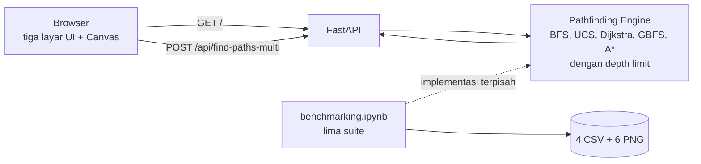
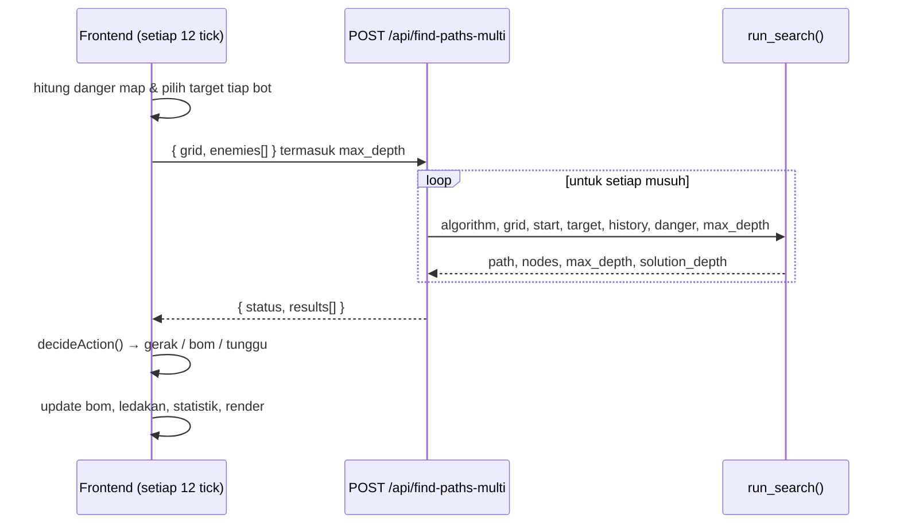

# Arsitektur

Dokumen ini menjelaskan bagaimana aplikasi BOMBERMAN Pathfinding disusun: komponen, alur request, UI tiga layar, siklus permainan, pengambilan keputusan bot, dan aturan arena.

## 1. Gambaran sistem

Sistem terdiri dari tiga bagian:

1. **Backend FastAPI** (`main.py`) — model Pydantic, engine pencarian path dengan batas depth, dan endpoint REST.
2. **Frontend kanvas** — HTML/CSS/JavaScript yang dikirim langsung dari `GET /`; menjalankan alur menu tiga layar, simulasi, dan rendering.
3. **Notebook benchmark** — implementasi algoritma yang berdiri sendiri untuk eksperimen batch dan ekspor CSV.



Aplikasi bersifat **stateless di sisi server**. Tidak ada sesi, database, atau penyimpanan skor. Seluruh state permainan (pilihan menu, grid, posisi bot, bom, statistik) berada di browser. Server hanya menerima snapshot grid dan daftar musuh, lalu mengembalikan path beserta metrik.

Tidak ada middleware CORS. UI dapat memanggil API karena disajikan dari origin yang sama; pemanggilan dari origin lain di browser akan diblokir.

## 2. Alur request



Properti penting:

- Satu request dapat memuat banyak musuh; server memprosesnya **berurutan**.
- Tidak ada cache path; setiap panggilan menghitung ulang dari snapshot terbaru.
- Frontend memakai guard `isFetching` agar request baru tidak dibuat sebelum request sebelumnya selesai.
- Urutan hasil diproses di frontend secara acak 50:50 setiap tick untuk mengurangi bias giliran.

## 3. Model data

```python
class EnemyInfo(BaseModel):
    id: int
    pos: List[int]                    # [baris, kolom]
    target: List[int]                 # [baris, kolom]
    algorithm: str = "A_STAR"         # BFS | UCS | DIJKSTRA | GBFS | A_STAR | A*
    max_depth: int = 0                # 0 = tak terbatas
    history: List[List[int]] = []
    danger: List[List[int]] = []

class MultiPathRequest(BaseModel):
    grid: List[List[int]]
    enemies: List[EnemyInfo]
```

Nilai grid:

| Nilai | Arti | Dapat dilalui pathfinding |
| --- | --- | --- |
| `0` | Lantai kosong | Ya, biaya `1.0` |
| `1` | Dinding permanen | Tidak |
| `2` | Dinding kayu | Ya, biaya `4.0` |
| `3` | Bom aktif | Tidak (ditangani escape planner frontend) |
| `4` | Ubin runtuh | Tidak |

Server hanya menerima `0` dan `2` sebagai ubin yang dapat dilalui. Bom dan ubin runtuh otomatis dianggap penghalang.

## 4. Engine pathfinding

Fungsi utama:

```python
run_search(
    algorithm, grid, start, target, history, danger, max_depth_limit=0
) -> (path, nodes_explored, max_depth, solution_depth)
```

Tahapan:

1. Normalisasi kode algoritma; kosong berarti `A_STAR`.
2. Acak urutan empat arah (`random.shuffle`) untuk tie-breaking netral.
3. Bangun `history_weights` dengan rumus `0.65 + index × 0.05` per kunjungan.
4. Bangun `danger_cells` dari daftar koordinat bahaya.
5. Jalankan algoritma dengan batas depth `max_depth_limit` (`0` = tanpa batas).
6. Jika target tidak tercapai, rekonstruksi path menuju node *fallback* terbaik.

### 4.1 Semantik depth limit

- `depth_from[start] = 0`.
- Node pada kedalaman `>= max_depth_limit` tetap dihitung sebagai node yang diekspansi, tetapi tidak menghasilkan tetangga baru.
- Target pada kedalaman lebih besar dari batas tidak akan pernah dicapai; server mengembalikan path parsial ke node terdekat.
- Nilai `0` berarti tak terbatas.
- UI menyediakan pilihan 2, 4, 6, 8, 12 (default), 16, 20, dan tak terbatas.

Depth dihitung sebagai jumlah edge, bukan biaya. Batas ini berlaku sama untuk kelima algoritma.

### 4.2 Fallback

Setiap algoritma melacak kandidat fallback dengan skor:

```text
skor = (jarak Manhattan ke target, biaya atau depth)
```

Kandidat dipilih secara leksikografis: jarak Manhattan terkecil lebih diutamakan, lalu biaya (untuk algoritma berbobot) atau depth (untuk BFS/GBFS). Jika tidak ada node selain start yang lebih dekat, `full_path` kosong.

Path fallback sekarang mengembalikan `solution_depth = len(path) - 1`, bukan `0`. Klien harus membandingkan `full_path` terakhir dengan target untuk mengetahui apakah target benar-benar tercapai.

Detail biaya dan pseudocode ada di [algoritma.md](algoritma.md).

## 5. Frontend

Frontend adalah satu halaman HTML dengan JavaScript vanila. Sejak pembaruan terakhir, UI memiliki **tiga layar** sebelum arena.

| Layar | ID | Tanggung jawab |
| --- | --- | --- |
| Menu utama | `screen-menu` | Memilih mode PvB atau BvB |
| Pilih map & settings | `screen-setup` | Memilih peta, karakter, algoritma, dan depth |
| Konfirmasi | `screen-confirm` | Menampilkan ringkasan dan tombol mulai |
| Arena | `arena-wrapper` | Simulasi, kontrol, dan panel analisis |

### 5.1 State UI

```javascript
const uiState = {
    mode: "PvB",
    mapKey: "classic",
    activeTab: 0,              // tab karakter: Player/Bot atau Bot 1/Bot 2
    selectedChars: [0, 1],     // indeks karakter untuk entitas 1 dan 2
    algoSingle: "A_STAR",      // algoritma bot pada mode PvB
    algoBot1: "A_STAR",
    algoBot2: "DIJKSTRA",
    maxDepth: 12
};
```

Karakter diambil dari `CHARACTERS`:

| ID | Nama | Peran |
| --- | --- | --- |
| 0 | IGNIS | Kosmetik |
| 1 | VECTRA | Kosmetik |
| 2 | KRONOS | Kosmetik |

Tidak ada buff atau perbedaan statistik. SVG karakter juga dipakai sebagai ikon di panel konfirmasi, HUD pemain, header tabel, dan sprite kanvas.

### 5.2 Kontroler UI

| Fungsi | Tanggung jawab |
| --- | --- |
| `goToUIScreen(id)` | Mengaktifkan satu layar dan menyembunyikan lainnya |
| `selectUIMode(mode)` | Menyimpan mode dan membuka layar setup |
| `chooseUIMap(key)` | Memilih peta dan memperbarui preview |
| `renderEntityTabs()` / `switchEntityTab()` | Tab karakter untuk tiap entitas |
| `renderCharacterCards()` / `chooseUICharacter()` | Memilih karakter kosmetik |
| `syncSetupState()` | Menyalin pilihan algoritma dan depth ke `uiState` |
| `renderUISetupScreen()` | Menampilkan kontrol yang sesuai mode |
| `goToConfirmScreen()` | Menyusun ringkasan konfirmasi |
| `initGame()` | Menyalin state UI ke grid, pemain, dan bot |

Tombol **OMKE GAS** memanggil `syncSetupState()`, mereset statistik, menjalankan `initGame()`, lalu membuka arena dan mengaktifkan simulasi. Mengubah pengaturan hanya dapat dilakukan setelah kembali ke layar setup; panel arena bersifat read-only.

### 5.3 Game loop

```javascript
let paused = true;

function gameLoop() {
    if (grid && !paused && !gameOver) {
        stepSimulationOnce();
    }
    if (grid) render();
    requestAnimationFrame(gameLoop);
}
```

- Tidak ada pengali kecepatan. Satu tick dijalankan per frame animasi.
- Simulasi dimulai dalam keadaan `paused = true`; **OMKE GAS** mengubahnya menjadi `false`.
- Tombol Jeda/Lanjut mengubah `paused`; tombol Step memanggil `stepSimulationOnce()` saat dijeda.
- Render berjalan setiap frame dan posisi karakter diinterpolasi dengan `lerp` agar gerak halus.

### 5.4 Urutan satu tick

`stepSimulationOnce()` mengeksekusi:

1. `simTicks++` dan memperbarui penghitung tick.
2. Setiap 20 tick: memperbarui HUD fase.
3. `updateSuddenDeathCollapse()` — pada SUDDEN DEATH, mungkin meruntuhkan sepasang ubin.
4. `updateBombsAndExplosions()` — mengurangi timer bom, memicu ledakan, mengurangi timer ledakan, i-frames, dan reload pemain.
5. Setiap 12 tick: `moveEnemiesRealtime()` memanggil API dan menerapkan aksi bot.

Karena pemanggilan API asinkron, respons dapat tiba setelah beberapa tick berjalan. Guard `isFetching` memastikan hanya satu request aktif.

### 5.5 Pemilihan target bot

`pickTarget()` menentukan target pathfinding:

- Mode BvB: target adalah bot lawan yang masih hidup.
- Mode PvB: target adalah pemain.
- Jika bot mendeteksi loop (`isLooping`) atau terlalu lama diam (`idle >= 8`), bot masuk state `BREAK_LOOP`, memilih target sayap acak di dekat lawan, dan mengabaikan target lama selama maksimal 18 tick.
- Selain itu, `getInterceptTarget()` memprediksi posisi lawan dari selisih posisi `prev` dan posisi saat ini, lalu menargetkan 1–2 ubin di depan lawan. Jika jarak ≤ 2, target langsung posisi lawan.

### 5.6 Keputusan aksi

`decideAction()` memakai urutan prioritas:

1. **Selamat dari ledakan** — jika ubin bot ada di `dangerTimes`, cari langkah aman dengan BFS lokal (maksimal 8 langkah) dan abaikan tujuan lain.
2. **Hancurkan kayu** — jika langkah berikutnya pada path adalah kayu, pasang bom bila aman, lalu tunggu ledakan.
3. **Serangan langsung / pinch trap** — bom jika lawan berada dalam jarak Manhattan ≤ 2 dan terkena area 3×3, atau jika fase mengizinkan dua bom dan lawan setengah terkepung. Ada cooldown bom dan daftar lokasi bom terakhir.
4. **Ikuti path** — bergerak ke node path berikutnya bila kosong, aman, dan belum diklaim bot lain.
5. **Fallback aman** — pilih arah acak yang kosong dan tidak berbahaya; jika tidak ada, tetap di tempat.

Ubin yang ditempati bot lain dilacak di `claimedTiles` untuk mencegah tumpang tindih. Urutan pemrosesan hasil API diacak agar tidak selalu bot yang sama bergerak lebih dulu.

### 5.7 Danger map dan reaksi berantai

`getDangerTimes()`:

1. Menghitung tile ledakan tiap bom dengan `blastTiles()` — kotak 3×3 di sekitar bom.
2. Menyesuaikan waktu efektif: jika ledakan bom lain lebih cepat mengenai ubin bom ini, bom tersebut ikut meledak lebih awal (propagasi maksimal 10 iterasi).
3. Mengembalikan `Map<"r,c", tick>` berisi waktu ledakan paling awal per ubin.

`getEscapeMove()` memakai BFS dengan batas 8 langkah dan margin keamanan 3 tick. Ubin dianggap aman jika tidak ada di danger map atau waktu ledakannya lebih lambat dari perkiraan tiba.

## 6. Fase dan penyusutan arena

```javascript
const OVERDRIVE_TICKS = 1200;    // ±20 detik pada satu tick/frame
const SUDDEN_DEATH_TICKS = 2100; // ±35 detik
```

| Fase | Mulai tick | Maks. bom/bot | Fuse bom bot |
| --- | --- | --- | --- |
| NORMAL | 0 | 1 | 60 tick |
| OVERDRIVE | 1200 | 2 | 48 tick |
| SUDDEN DEATH | 2100 | 3 | 36 tick |

Catatan:

- Fase tidak lagi mengubah kecepatan simulasi karena kontrol kecepatan sudah dihapus.
- Bom pemain memakai timer tetap 110 tick dan tidak mengikuti fase.

Penyusutan arena:

- Hanya berjalan pada SUDDEN DEATH.
- Setiap 75 tick, satu pasang ubin simetris 180° diubah menjadi `4` (runtuh).
- Pasangan dibangun lapis demi lapis dari tepi ke dalam (`buildSymmetricSpiralPairs`), menyisakan pusat 3×5 (`baris 5–7`, `kolom 5–9`).
- Bom di ubin yang runtuh dihapus; karakter di sana langsung tereliminasi tanpa i-frames.
- Jika pemain PvB terjepit, bot dinyatakan menang.

## 7. Peta

Tiga peta tersedia:

| Kunci | Nama | Cara pembuatan |
| --- | --- | --- |
| `classic` | Klasik | Template tetap `MAP_TEMPLATE` 13×15 dengan lorong dan banyak kayu |
| `corridor` | Koridor | Generator simetris berpola dinding vertikal di kolom 3, 7, 11 dan horizontal di baris 4, 8, dengan celah periodik |
| `open` | Terbuka | Generator simetris dengan dinding permanen jarang dan sebagian besar lantai |

Semua peta melewati `validateMaps()`:

1. **Simetri 180°** — `grid[r][c] === grid[ROWS-1-r][COLS-1-c]`.
2. **Konektivitas** — flood fill dari spawn `(1,1)` harus mencapai spawn `(11,13)`.
3. **Keamanan spawn** — tiga ubin di sekitar tiap spawn harus lantai kosong.

Jika validasi gagal, aplikasi melempar error di browser dan simulasi tidak dimulai. Ini menjaga keadilan eksperimen: kedua entitas selalu mendapat area awal yang setara.

## 8. Statistik seri

`seriesStats` menyimpan, untuk masing-masing bot:

- jumlah kemenangan,
- total dan rata-rata `nodes_explored`,
- total dan rata-rata `exec_time_ms`,
- total dan rata-rata `max_depth`,
- total dan rata-rata `solution_depth`,
- jumlah pemanggilan API sebagai penyebut rata-rata.

Statistik di-reset saat klik **OMKE GAS** atau **Ulang ronde**, dan bertahan setelah simulasi berakhir sampai ronde berikutnya dimulai.

Kemenangan dicatat sebagai berikut:

| Kondisi | Hasil |
| --- | --- |
| Satu bot tersisa di BvB | Kemenangan bot tersebut |
| Kedua bot mati bersamaan | Seri (double KO) |
| Pemain PvB mati | Kemenangan bot |
| Bot PvB mati | Kemenangan pemain |

Panel analisis juga menampilkan **Batas Depth** untuk masing-masing bot dan indikator depth pada status strip (`∞` untuk tak terbatas).

## 9. Konkurensi dan performa

- Server FastAPI sinkron; setiap request memproses musuh secara berurutan. Dengan grid 15×13, beban sangat kecil.
- `exec_time_ms` diukur hanya di sekitar `run_search`, tidak termasuk serialisasi JSON dan latensi jaringan.
- Batas depth dapat menurunkan jumlah node secara drastis, tetapi juga membuat target jauh tidak tercapai.
- `max_depth` dihitung langsung dari `depth_from` selama ekspansi, sehingga lebih murah daripada versi sebelumnya yang menelusuri parent per node.
- Pencarian berjalan di event loop proses Uvicorn; untuk beban besar, endpoint dapat diubah menjadi `async` dengan `run_in_threadpool`.

## 10. Titik ekstensi

- **Algoritma baru** — tambahkan cabang pada `run_search`, lalu tambahkan opsi di `ALGO_LABELS` dan kedua `<select>`.
- **Peta baru** — tambahkan entri `MAPS`, buat generator/template, dan pastikan lolos `validateMaps()`.
- **Karakter baru** — tambahkan objek SVG pada `CHARACTERS`; tidak perlu mengubah logika permainan.
- **Aturan bom** — ubah `blastTiles`, `phase.fuse`, atau `phase.maxBombs`.
- **Metrik baru** — tambahkan field pada hasil endpoint dan kolom pada tabel analisis.
- **Pilihan depth** — ubah opsi `#ui-depth-select` dan label `DEPTH_LABELS`.
